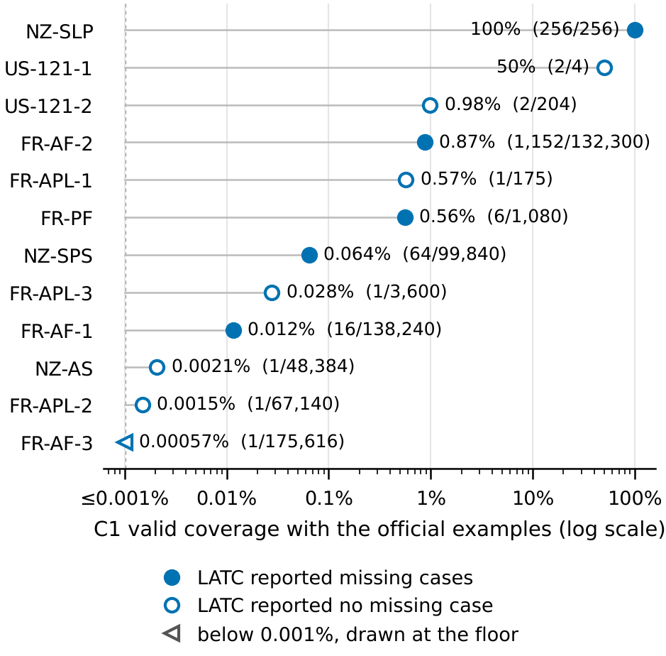
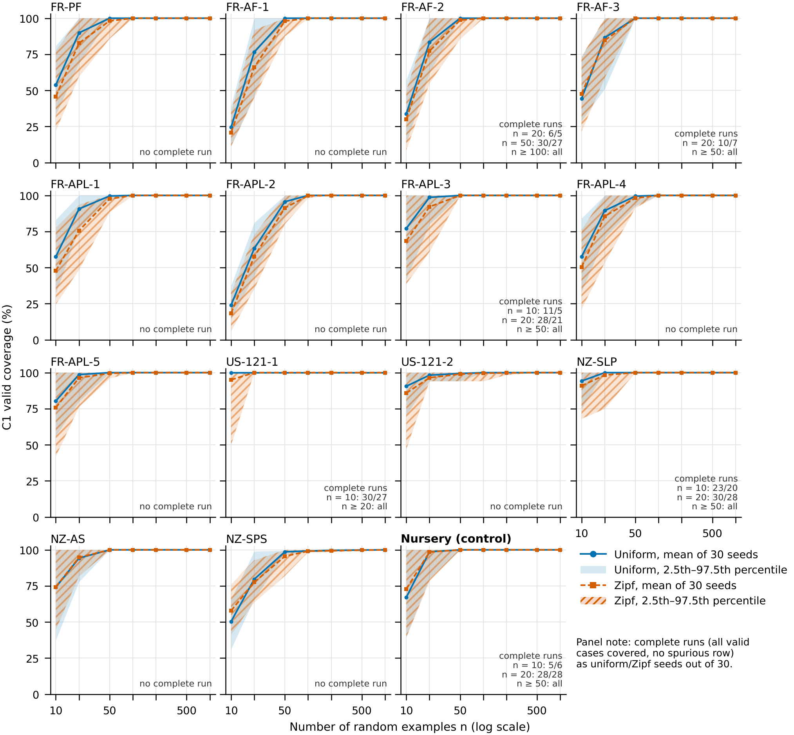
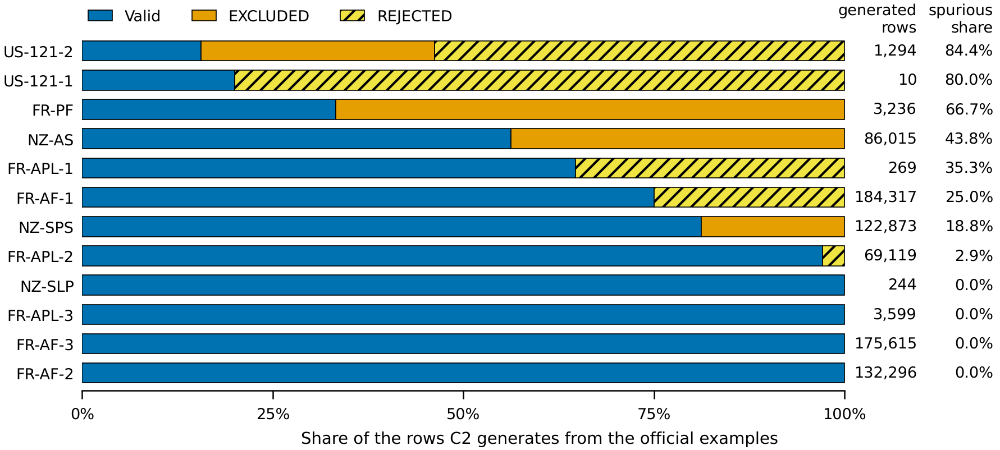

# Paper C figures: drafts for the author's approval

Everything here is a draft. Nothing goes into the manuscript until the author approves it.

**Status: 343 of 345 cross-checks pass. Two values printed in the paper disagree with
the data (see "Mismatches" below).** The data were left as they are. `make_figures.py`
exits with status 1 until the printed values agree with the data.

## Files

| File | Content |
|---|---|
| `make_figures.py` | the only script; reads only `paperC/results/<ID>/{runs.csv,summary.md}` and `SOURCES.csv` |
| `requirements.lock` | pinned environment (matplotlib 3.9.2, numpy 2.1.3; run with Python 3.13) |
| `SOURCES.csv` | branch, commit and git blob hash of every copied result file; the script checks each hash |
| `fig1_official_coverage.{pdf,png}`, `fig1_data.csv` | Figure 1, single-column width (8.5 cm) |
| `fig2_coverage_vs_n.{pdf,png}`, `fig2_data.csv` | Figure 2, double-column width (17.8 cm) |
| `fig3_c2_generated.{pdf,png}`, `fig3_data.csv` | Figure 3, double-column width (17.8 cm) |
| `fig_checks.csv` | all 345 cross-checks with observed value, expected value and result |

PNGs are 300 dpi. Colours come from the Okabe–Ito palette. Each pair of series also differs
in grey level, line style, marker or hatching, so the figures still read in greyscale.

Reproduce from the repository root:

```
python3 -m venv .venv && .venv/bin/pip install -r paperC/figures/requirements.lock
.venv/bin/python paperC/figures/make_figures.py
```

### Data sources

The result folders were copied byte for byte into `paperC/results/` on this branch:

| Tables | Branch | Commit |
|---|---|---|
| FR-PF, FR-AF-1, FR-AF-2, FR-AF-3 | `paperc-run-fr` | `7099c6b` |
| FR-APL-1 to FR-APL-5, US-121-1 | `paperc-run-fr2` | `eb508e7` |
| **US-121-2 (corrected)** | `paperc-data-fr2-fix` | `1b9debe` |
| **NZ-SLP (corrected)** | `paperc-data-nz-fix` | `acd42a0` |
| NZ-AS, NZ-SPS | `paperc-run-nz` | `b835740` |
| CTRL-NUR (Nursery control) | `paperc-harness` | identical blob on every run branch |

The older US-121-2 and NZ-SLP results on `paperc-run-fr2` and `paperc-run-nz` are not used.

---

## Figure 1. Official-example coverage per table



**Draft caption.** C1 valid coverage (LATC as published, product of the observed values)
when the examples are the encoding's own official test cases, for the 12 tables that have
official examples. FR-APL-4 and FR-APL-5 have no official examples and are left out. The
x-axis is logarithmic. Labels give the share and the count of valid cases covered, and
FR-AF-3 (1 of 175,616) is drawn at the 0.001% floor. Open circles mark the seven tables
where LATC reported no missing case at all. In ten of the twelve tables the official
examples reach less than 1% of the valid cases, and only NZ-SLP is completed.

**What is plotted** (`fig1_data.csv`): OFFICIAL, condition C1, `valid_coverage`
(= `covered_valid` / |V|). A dot is open when `reported_missing` ≤ 0 and `workload` = 0.
US-121-1 has `reported_missing` = −2: its four official rows outnumber the product of the
observed values (2), and LATC generates nothing.

## Figure 2. Coverage versus number of random examples



**Draft caption.** Mean C1 valid coverage over 30 seeds against the number n of random
examples, drawn uniformly (solid line, plain band) or with Zipf weights (dashed line,
hatched band). The bands span the 2.5th to 97.5th percentiles over the seeds, and the last
panel is the UCI Nursery control. The note in each panel counts complete runs, meaning all
valid cases covered with no spurious row, as uniform/Zipf seeds out of 30. Random examples
cover almost every valid case by n = 100 (the mean is at least 99% in every table). Nine of the
fourteen legal tables still never have a complete run, because C1 also generates EXCLUDED
or REJECTED rows.

**What is plotted** (`fig2_data.csv`): UNIFORM and ZIPF, condition C1, n ∈ {10, 20, 50,
100, 200, 500, 1000}, seeds 0–29; mean, type-7 percentiles (PROTOCOL.md section 8) and
the count of `complete` = 1. Fourteen legal panels plus Nursery fit in a 4 × 4 grid, and
the sixteenth cell holds the legend. The panels share both axes.

## Figure 3. What C2 generates with the official examples



**Draft caption.** The rows that C2 (declared domains, no exclusions) generates from the
official examples, split into valid, EXCLUDED and REJECTED rows, for the 12 tables with
official examples. The right-hand columns give the number of generated rows and the
spurious share (EXCLUDED plus REJECTED). In eight of the twelve tables C2 generates
spurious rows, from 2.9% (FR-APL-2) to 84.4% (US-121-2), and in US-121-1 and US-121-2
most of them are REJECTED rows that raise an error in the encoding.

**What is plotted** (`fig3_data.csv`): OFFICIAL, condition C2; valid = `workload` −
`spurious_excluded` − `spurious_rejected`. Bars are sorted by spurious share. US-121-2 and
NZ-SLP use the corrected tables.

---

## Cross-checks: 343 / 345 passed

| Group | Checks | Passed |
|---|---:|---:|
| Copied result files match the git blob on the source branch (`SOURCES.csv`) | 45 | 45 |
| Fig. 1: `covered_valid`/\|V\| equals `valid_coverage`; value equals `summary.md` | 24 | 24 |
| Fig. 1: C1 official coverage against Table 2 | 12 | **11** |
| Fig. 1: FR-APL-4 and FR-APL-5 have no OFFICIAL runs | 2 | 2 |
| Fig. 2: mean, p2.5 and p97.5 recomputed from `runs.csv` equal `summary.md` (15 tables × 2 sources × 7 sizes) | 210 | 210 |
| Fig. 2: n = 10 means against Table 3 (5 tables × 2 sources) | 10 | **9** |
| Fig. 2: n = 10 means against the text (NZ-AS ≈ 74%, NZ-SPS 50–58%) | 4 | 4 |
| Fig. 2: NZ-SLP complete seeds at n = 10 (23/30 uniform, 20/30 Zipf) | 2 | 2 |
| Fig. 3: spurious share recomputed from counts equals `runs.csv` and `summary.md` | 24 | 24 |
| Fig. 3: C2 spurious share against Table 2 | 12 | 12 |
| **Total** | **345** | **343** |

A value printed in the paper passes when the data, rounded to the printed precision, give
the printed figure. "<0.01%" means strictly between 0 and 0.01%. "0%" means exactly zero.

### Mismatches (author to decide; the data were not changed)

1. **Table 2, FR-AF-3, C1 valid coverage with the official examples.** The paper prints
   **0%**. The data give **1/175,616 = 0.00057%** (`covered_valid` = 1). The single
   official example is itself a valid case, and C1 generates no row (`workload` = 0).
   Table 2 prints "<0.01%" for FR-APL-2 (0.0015%) and NZ-AS (0.0021%), which are on the
   same footing. Suggested fix: print "<0.01%" for FR-AF-3 as well. If "0%" is meant as
   "C1 generated nothing", the column would need a different definition, and that would
   also apply to FR-APL-1, FR-APL-2, FR-APL-3, US-121-1, US-121-2 and NZ-AS. Figure 1
   shows the data value, drawn at the 0.001% floor.
2. **Table 3, FR-AF-1, Zipf, n = 10.** The paper prints **20.8**. The mean over 30 seeds is
   **20.747%**, which rounds to **20.7**. `summary.md` prints 0.2075, and rounding that
   figure a second time gives 20.8. Suggested fix: print 20.7. The other nine Table 3
   values agree whether they are rounded from the exact means or from `summary.md`.

Once Table 2 and Table 3 are corrected, update `TABLE2["FR-AF-3"]` and
`TABLE3["FR-AF-1"]` in `make_figures.py`. The script then exits with status 0.

## Suggested placement

* **Figure 1:** near Table 2, in Sections 4.1–4.2 (official examples and H1).
* **Figure 2:** near Table 3 (random examples and coverage against n).
* **Figure 3:** Section 4.7, under H2 (spurious rows without exclusions).
